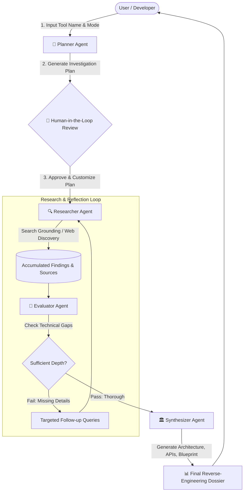

# 🔬 DeepSearch Reverse-Engineering Agent

[](https://www.python.org/downloads/)
[](https://streamlit.io/)
[](https://github.com/google/adk-recipes)
[](https://aistudio.google.com/)

An autonomous multi-agent intelligence platform designed to **reverse engineer software tools, SaaS products, AI agents, APIs, protocols, and system architectures**.

Inspired by and adapted from the official [Google Agent Development Kit (ADK) Deep-Search Recipe](https://github.com/google/adk-recipes/tree/main/core/python/deep-search), this system combines multi-stage planning, Human-in-the-Loop (HITL) plan verification, search grounding, reflective evaluation loops, and synthesis into a streamlined **Streamlit UI**.

---

## 🌟 Key Capabilities

- 🏗️ **System Architecture & Tech Stack Teardown:** Uncover frontend frameworks, backend engines, databases, cache layers, and edge runtimes used by any target tool.
- 🔌 **API & Protocol Reverse Engineering:** Extract inferred/documented REST, GraphQL, WebSocket, gRPC, and Server-Sent Event (SSE) endpoints, request/response payload schemas, and headers.
- ⚙️ **Internal Logic & Workflow Reconstruction:** Unpack internal state machines, job queues, algorithms, caching strategies, and AI prompt pipelines.
- 🔄 **Human-in-the-Loop (HITL) Verification:** Review, modify, and approve the multi-dimensional investigation plan before the agent starts deep research.
- 🧐 **Evaluator & Reflection Loop:** An autonomous critic inspects research completeness; if critical technical gaps remain, it triggers targeted follow-up queries.
- 🛠️ **Open-Source Reconstruction Blueprint:** Automatically generates a step-by-step guide with recommended open-source stacks, directory structures, and starter code skeletons to rebuild the tool.
- 📊 **Visual Mermaid Flowcharts:** Auto-generates clean, interactive architectural and sequence diagrams.
- 📥 **Export Ready:** Download the complete dossier as Markdown (`.md`) or structured JSON with one click.

---

## 🧠 Multi-Agent Architecture (Google ADK Flow)



---

## 🚀 Quick Start (Local Setup)

### 1. Prerequisites
- Python 3.10+
- A Google Gemini API Key from [Google AI Studio](https://aistudio.google.com/app/apikey)

### 2. Configure Environment
Copy `.env.example` to `.env` and add your Gemini API Key:

```bash
cp .env.example .env
```

Edit `.env`:
```env
GEMINI_API_KEY="your_actual_gemini_api_key_here"
GEMINI_MODEL="gemini-2.5-flash"
```

### 3. Run with One Command
Execute the automated launch script:

```bash
./run.sh
```

Or manually:
```bash
# 1. Create virtual environment
python3 -m venv .venv
source .venv/bin/activate

# 2. Install dependencies
pip install -r requirements.txt

# 3. Launch Streamlit app
streamlit run app.py
```

The application will open in your browser at `http://localhost:8501`.

---

## 📦 How to Push to Your Own GitHub Repository

Follow these step-by-step commands to push this project to your GitHub account:

### Step 1: Create a new repository on GitHub
1. Go to [github.com/new](https://github.com/new).
2. Enter a repository name (e.g. `deep-search-reverse-eng` or `tool-reverse-engineering-agent`).
3. Leave "Initialize this repository with a README" **unchecked** (we already have one).
4. Click **Create repository**.
5. Copy your repository URL (e.g. `https://github.com/<your-username>/deep-search-reverse-eng.git`).

### Step 2: Push from your local terminal
Inside this directory (`/Users/apple/.gemini/antigravity-ide/scratch/deep-search-reverse-eng`):

```bash
cd /Users/apple/.gemini/antigravity-ide/scratch/deep-search-reverse-eng

# 1. Verify git status
git status

# 2. Add your GitHub remote repository (replace with your repo URL)
git remote add origin https://github.com/<your-username>/<your-repo-name>.git

# 3. Rename branch to main (if not already main)
git branch -M main

# 4. Push all code to your GitHub repo
git push -u origin main
```

*(Note: If you use GitHub CLI `gh`, you can also simply run: `gh repo create deep-search-reverse-eng --public --source=. --push`)*

---

## 🎯 Pre-Configured Presets Included

The UI includes 1-click presets for reverse engineering popular modern tools:

1. **Cursor AI Editor**: Analyzes codebase semantic indexing, shadow workspace, Composer agent loop, and VS Code language server interception.
2. **Perplexity AI Pro Search**: Analyzes query expansion, multi-source scraping/SERP orchestration, reranker models, and SSE streaming.
3. **v0.dev by Vercel**: Analyzes React/Tailwind/Lucide AST generation, Sandpack live preview runtimes, and component patch streaming.
4. **Stripe Checkout & Webhooks**: Analyzes hosted checkout sessions, HMAC-SHA256 signature verification, and idempotent retry queues.
5. **Temporal.io / Inngest**: Analyzes event sourcing replay architecture, deterministic workflow constraints, and gRPC worker communication.

---

## 📁 Project Structure

```
deep-search-reverse-eng/
├── .env.example              # Environment variables template
├── .gitignore                # Git ignore rules for Python & Streamlit
├── README.md                 # Complete documentation & guide
├── requirements.txt          # Python dependencies
├── run.sh                    # One-click setup & launch script
├── app.py                    # Streamlit Web Application UI
└── deep_search_agent/        # Core Agentic Package (ADK Pattern)
    ├── __init__.py           # Package exports
    ├── models.py             # Pydantic schemas (Plans, Findings, Dossier)
    ├── gemini_client.py      # Gemini 2.5 SDK wrapper & Search Grounding
    ├── planner.py            # Dimension decomposition agent
    ├── researcher.py         # Search grounding & discovery agent
    ├── evaluator.py          # Reflection & gap critique agent
    ├── synthesizer.py        # Dossier & blueprint synthesis agent
    └── presets.py            # Quick-start target presets
```

---

## 🛡️ License

Apache License 2.0. Inspired by Google's Agent Development Kit (ADK) recipes.
